<!-- Generated by scripts/build_assets.py. Edit data/portfolio.json and data/projects.json. -->

<picture>
  <source media="(max-width: 600px) and (prefers-reduced-motion: reduce)" srcset="assets/generated/hero-mobile-static.svg">
  <source media="(prefers-reduced-motion: reduce)" srcset="assets/generated/hero-static.svg">
  <source media="(max-width: 600px)" srcset="assets/generated/hero-mobile.svg">
  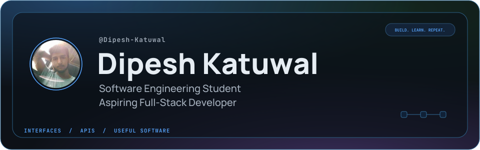
</picture>

I'm a software engineering student interested in full-stack development, backend engineering, and building useful software products. My projects connect React interfaces with Spring Boot REST APIs and databases.

[GitHub](https://github.com/Dipesh-Katuwal)

[Toolkit](#toolkit) · [Projects](#selected-projects) · [Statistics](#github-statistics) · [Contribution history](#contribution-history) · [Recent activity](#recent-activity) · [Connect](#connect)

## Toolkit

<picture>
  <source media="(max-width: 600px)" srcset="assets/generated/stack-mobile.svg">
  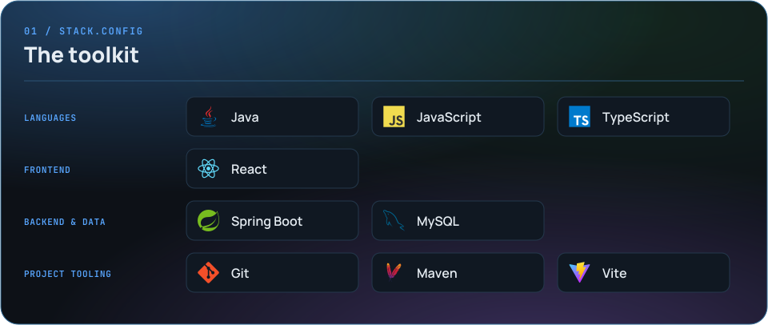
</picture>

**Technical interests:** Full-stack development · Backend engineering · Useful software products.

## Selected projects

<picture>
  <source media="(max-width: 600px)" srcset="assets/generated/projects-header-mobile.svg">
  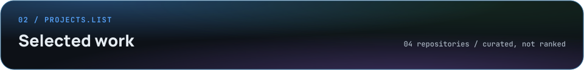
</picture>

<a href="https://github.com/Dipesh-Katuwal/BillingSoftware">
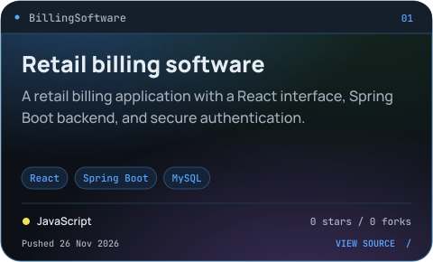
</a>
&nbsp;
<a href="https://github.com/Dipesh-Katuwal/AiResumeAnalyzer">
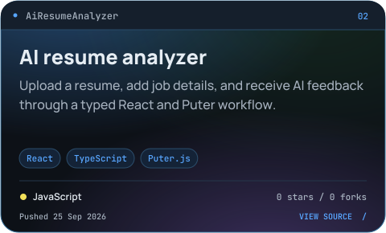
</a>

<a href="https://github.com/Dipesh-Katuwal/DarazClone">
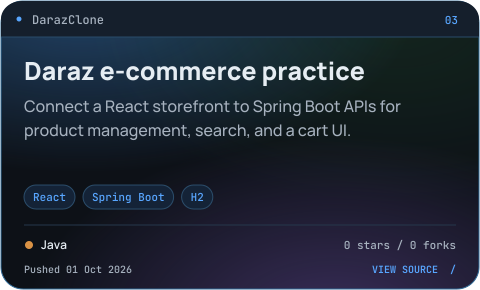
</a>
&nbsp;
<a href="https://github.com/Dipesh-Katuwal/EMS">
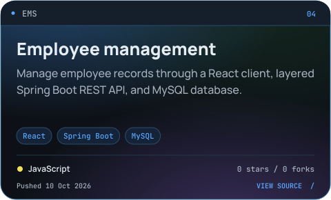
</a>

<a href="https://github.com/Dipesh-Katuwal/Projects_in_C">
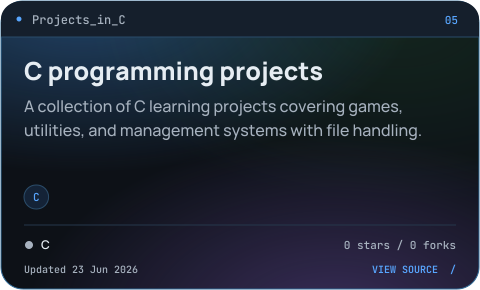
</a>

**Try a project:** [AI resume analyzer — live demo](https://airesumeanalyzer.puter.site/)

Project descriptions and source links

- [BillingSoftware](https://github.com/Dipesh-Katuwal/BillingSoftware) — A retail billing application with a React interface, Spring Boot backend, and secure authentication.
- [AiResumeAnalyzer](https://github.com/Dipesh-Katuwal/AiResumeAnalyzer) — Upload a resume, add job details, and receive AI feedback through a typed React and Puter workflow.
- [DarazClone](https://github.com/Dipesh-Katuwal/DarazClone) — Connect a React storefront to Spring Boot APIs for product management, search, and a cart UI.
- [EMS](https://github.com/Dipesh-Katuwal/EMS) — Manage employee records through a React client, layered Spring Boot REST API, and MySQL database.
- [Projects_in_C](https://github.com/Dipesh-Katuwal/Projects_in_C) — A collection of C learning projects covering games, utilities, and management systems with file handling.

## GitHub statistics

<picture>
  <source media="(max-width: 600px)" srcset="assets/generated/statistics-mobile.svg">
  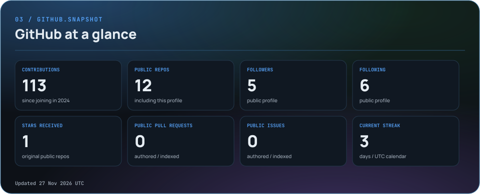
</picture>

<picture>
  <source media="(max-width: 600px)" srcset="assets/generated/languages-mobile.svg">
  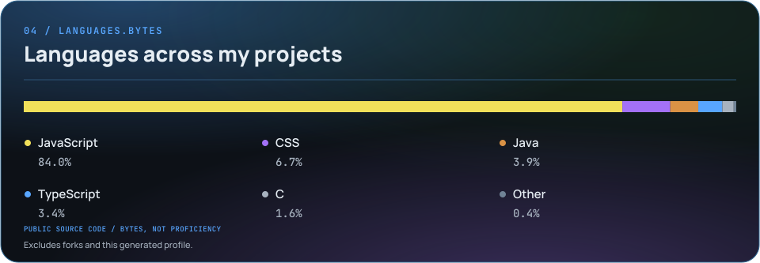
</picture>

## Contribution history

<picture>
  <source media="(max-width: 600px) and (prefers-color-scheme: light) and (prefers-reduced-motion: reduce)" srcset="assets/generated/calendar-mobile-light-static.svg">
  <source media="(prefers-color-scheme: light) and (prefers-reduced-motion: reduce)" srcset="assets/generated/calendar-light-static.svg">
  <source media="(max-width: 600px) and (prefers-reduced-motion: reduce)" srcset="assets/generated/calendar-mobile-static.svg">
  <source media="(prefers-reduced-motion: reduce)" srcset="assets/generated/calendar-static.svg">
  <source media="(max-width: 600px) and (prefers-color-scheme: light)" srcset="assets/generated/calendar-mobile-light.svg">
  <source media="(prefers-color-scheme: light)" srcset="assets/generated/calendar-light.svg">
  <source media="(max-width: 600px)" srcset="assets/generated/calendar-mobile.svg">
  
</picture>

**Contributions by year:** [2024: 1](https://github.com/Dipesh-Katuwal?tab=overview&from=2024-01-01&to=2024-12-31) · [2025: 0](https://github.com/Dipesh-Katuwal?tab=overview&from=2025-01-01&to=2025-12-31) · [2026: 106](https://github.com/Dipesh-Katuwal?tab=overview&from=2026-01-01&to=2026-12-31)

[Open GitHub contribution history](https://github.com/Dipesh-Katuwal?tab=overview) · [Static calendar](assets/generated/calendar-static.svg)

## Recent activity

<picture>
  <source media="(max-width: 600px)" srcset="assets/generated/recent-mobile.svg">
  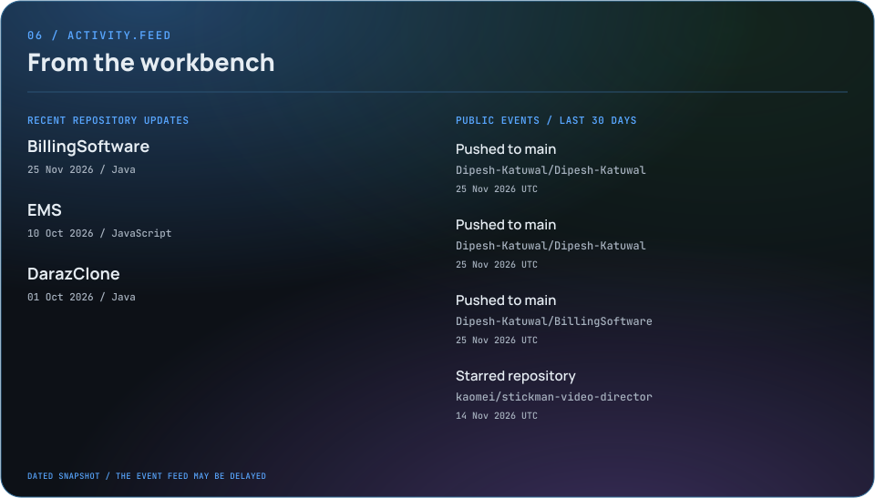
</picture>

Open activity and repository links

**Repository updates**

- 2026-11-25 — [BillingSoftware](https://github.com/Dipesh-Katuwal/BillingSoftware)
- 2026-10-10 — [EMS](https://github.com/Dipesh-Katuwal/EMS)
- 2026-10-01 — [DarazClone](https://github.com/Dipesh-Katuwal/DarazClone)

**Public events returned in the last 30 days**

- 2026-11-14 — [Starred repository · kaomei/stickman-video-director](https://github.com/kaomei/stickman-video-director)
- 2026-10-29 — [Pushed to main · Dipesh-Katuwal/BillingSoftware](https://github.com/Dipesh-Katuwal/BillingSoftware/commit/6dae9c07b074407468c84b99a0e06401e6a2d643)
- 2026-10-29 — [Pushed to main · Dipesh-Katuwal/BillingSoftware](https://github.com/Dipesh-Katuwal/BillingSoftware/commit/46225b860fa691bc8dfd64d80f958a87254504a0)
- 2026-10-28 — [Pushed to main · Dipesh-Katuwal/BillingSoftware](https://github.com/Dipesh-Katuwal/BillingSoftware/commit/9d3982a1d25f77b54a5a1c2f53027fb2f6f9abfe)

## Connect

<picture>
  <source media="(max-width: 600px)" srcset="assets/generated/footer-mobile.svg">
  
</picture>

[GitHub](https://github.com/Dipesh-Katuwal)

Public GitHub snapshot · Updated 25 Nov 2026 UTC · Generated daily; GitHub may cache images.
