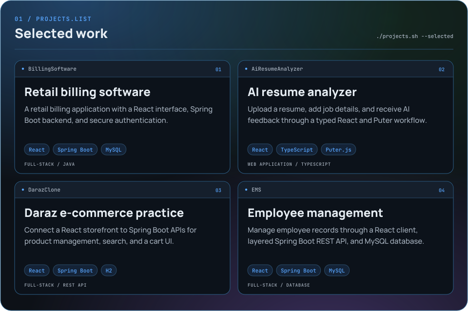

<picture>
  <source media="(max-width: 600px)" srcset="assets/generated/hero-mobile.svg">
  
</picture>

I'm a software engineering student interested in **full-stack development, backend engineering, and building useful software products**. My projects connect React interfaces with Spring Boot REST APIs and databases.

<picture>
  <source media="(max-width: 600px)" srcset="assets/generated/stack-mobile.svg">
  
</picture>

<picture>
  <source media="(max-width: 600px)" srcset="assets/generated/projects-mobile.svg">
  
</picture>

**Explore the code:** [BillingSoftware](https://github.com/Dipesh-Katuwal/BillingSoftware) · [AiResumeAnalyzer](https://github.com/Dipesh-Katuwal/AiResumeAnalyzer) · [DarazClone](https://github.com/Dipesh-Katuwal/DarazClone) · [EMS](https://github.com/Dipesh-Katuwal/EMS)

<picture>
  <source media="(max-width: 600px) and (prefers-reduced-motion: reduce)" srcset="assets/generated/activity-mobile-static.svg">
  <source media="(prefers-reduced-motion: reduce)" srcset="assets/generated/activity-static.svg">
  <source media="(max-width: 600px)" srcset="assets/generated/activity-mobile.svg">
  
</picture>

[View contribution history](https://github.com/Dipesh-Katuwal?tab=overview) · [Static calendar](assets/generated/activity-static.svg)

<a href="https://github.com/Dipesh-Katuwal">
  <picture>
    <source media="(max-width: 600px)" srcset="assets/generated/footer-mobile.svg">
    
  </picture>
</a>
